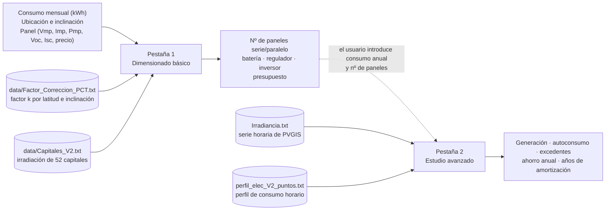

# Dimensionado y análisis de instalaciones fotovoltaicas

Aplicación de escritorio para Windows (C++/CLI, Windows Forms) que dimensiona una instalación solar
fotovoltaica y estima su producción, autoconsumo y rentabilidad. Tiene dos pestañas (formularios):

| Pestaña | Fichero | Para qué sirve |
|---|---|---|
| **Dimensionado básico** | `src/Form1.h` | A partir del consumo mensual, la ubicación y el panel elegido calcula nº de paneles (serie/paralelo), batería, regulador, inversor y un presupuesto orientativo. |
| **Estudio avanzado** (se abre con el botón inferior «Comzar estudio detallado», tal como está escrito en la interfaz) | `src/Resultado.h` | Con una serie horaria de irradiancia (PVGIS) y un perfil de consumo horario calcula generación, autoconsumo, excedentes, ahorro anual y años de amortización. |

> **Estado del proyecto.** El código se ha reconstruido a partir de listados en PDF de un proyecto de Visual Studio.
> La lectura de ficheros de datos se ha probado de forma independiente con g++; la compilación completa del proyecto
> WinForms hay que hacerla en Visual Studio (ver [Compilar](#compilar)); los ficheros `.sln`/`.vcxproj` tampoco se han abierto aún en Visual Studio. Las constantes de coste y varios criterios de
> diseño son orientativos: lee [`docs/PROBLEMAS_CONOCIDOS.md`](docs/PROBLEMAS_CONOCIDOS.md) antes de fiarte de los resultados.

## Cómo funciona



### Pestaña 1 · Dimensionado básico
1. **Método de diseño** (botón *Cambiar*): *Peor mes* (se dimensiona para el mes más desfavorable, instalación aislada / autoconsumo) o *Promedio mensual* (conectado a red, con la media anual).
2. **Consumo [kWh]** de cada mes y **Potencia [W]** requerida (decide la tensión del sistema: 12, 24, 48 o 120 V).
3. **Ubicación**: latitud (25–45 º), longitud (−19–5 º), inclinación y azimut (0 º = sur). Con ellos el programa busca el factor de
   corrección *k* por latitud/inclinación, la irradiación de la capital de provincia más cercana y descuenta las pérdidas por orientación.
4. **Selección del panel**: por defecto un módulo de 450 Wp (Vmp 42,06 V, Imp 10,7 A, Voc 50,43 V, Isc 11,36 A, 170 €, 2,20 m²).
   Se puede cambiar y pulsar *Actualizar valores*.
5. **Calcula** → muestra paneles (serie, paralelo, total, área), batería (Ah, V), inversor (W), regulador (V y A máximos) y el desglose de la inversión.

### Pestaña 2 · Estudio avanzado
1. Introduce el **consumo anual** y el **número de paneles** (la pestaña 1 no le pasa datos).
2. Pulsa **Buscar en fichero**: lee `Irradiancia.txt` y `perfil_elec_V2_puntos.txt` de la carpeta del `.exe`.
3. Para cada una de las 8760 horas: `generación = G(i)/10⁶ · Pmp · nº paneles · 0,8` y `consumo = perfil · consumo anual`;
   el autoconsumo es el mínimo de ambos y la diferencia positiva son excedentes.
4. Resultados: tabla mensual (consumo, generación, excedentes, autoconsumo), % de autoconsumo sobre consumo y sobre producción,
   ahorro (0,40 €/kWh autoconsumido + 0,10 €/kWh de excedentes), desglose de la inversión y **años para recuperarla**.

Fórmulas, constantes y criterios de redondeo, paso a paso: [`docs/FUNCIONAMIENTO.md`](docs/FUNCIONAMIENTO.md).

## Compilar

### Requisitos
Windows y **Visual Studio 2022** (la edición Community es gratuita). En el instalador de Visual Studio marca:
- la carga de trabajo **Desarrollo para el escritorio con C++**, y
- en *Componentes individuales*: **Compatibilidad con C++/CLI para herramientas de compilación v143 (x86 y x64)** (en inglés,
  *C++/CLI support for v143 build tools*) y **Paquete de orientación de .NET Framework 4.8**.

### Abrir el proyecto
1. Descarga o clona el repositorio.
2. Abre **`Prueba1.sln`** (Archivo → Abrir → Proyecto o solución). Si Visual Studio propone *volver a destinar* el proyecto
   (versión de Windows SDK o del conjunto de herramientas), acepta.
3. Elige **Debug** y **x64** en la barra superior.
4. Menú *Compilar → Compilar solución* (`Ctrl+Mayús+B`) y después *Depurar → Iniciar depuración* (`F5`).

El proyecto ya incluye un evento posterior a la compilación que copia los `.txt` de [`data/`](data) junto al `.exe`
(`x64\Debug\`); en Debug copia además los ficheros de ejemplo de Valencia, para poder probar la pestaña 2 de inmediato.
Para un uso real, coloca en esa carpeta tu `Irradiancia.txt` y tu `perfil_elec_V2_puntos.txt`.

### Notas
- Visual Studio 2019 y posteriores **no incluyen el diseñador visual de formularios para C++/CLI**: los `.h` se editan como código
  (la parte de diseño está en `InitializeComponent`), pero compilan y se ejecutan con normalidad.
- Los ficheros `Prueba1.sln` y `src/Prueba1.vcxproj` se han escrito siguiendo la estructura estándar de un proyecto C++/CLI.
  Si Visual Studio no los abriera, crea un proyecto **CLR Empty Project (.NET Framework)** llamado `Prueba1`, añade los ficheros de
  `src/` y en *Propiedades del proyecto* configura: *Compatibilidad con Common Language Runtime* = `/clr`; *Subsistema* = Windows
  (`/SUBSYSTEM:WINDOWS`); *Punto de entrada* = `main`; *Comprobaciones básicas en tiempo de ejecución* = Predeterminado; encabezado
  precompilado = Usar `pch.h` (y *Crear* en `pch.cpp`); y referencias a `System`, `System.Data`, `System.Drawing`,
  `System.Windows.Forms` y `System.Xml`.

## Ficheros de datos

| Fichero | Quién lo aporta | Contenido |
|---|---|---|
| `Factor_Correccion_PCT.txt` | incluido en [`data/`](data) | Factor *k* (superficie inclinada / horizontal) por mes, para latitudes 28, 29 y 34–45 º e inclinaciones de 0 a 90 º cada 5 º. |
| `Capitales_V2.txt` | incluido en [`data/`](data) | Irradiación diaria media mensual (kWh/m²·día) de las 52 capitales de provincia. |
| `Irradiancia.txt` | **el usuario** | Serie horaria de irradiancia sobre el plano inclinado descargada de [PVGIS](https://re.jrc.ec.europa.eu/pvg_tools/es/) (se puede usar el CSV tal cual, renombrado). |
| `perfil_elec_V2_puntos.txt` | **el usuario** | Perfil de consumo horario del hogar, un valor por línea, normalizado para que sume 1 en el año. |

Los dos primeros se generan desde los Excel de [`data/fuentes/`](data/fuentes) con `python tools/generar_datos.py`
(requiere `pip install openpyxl numpy`). Formatos exactos y cómo obtener los dos últimos: [`docs/DATOS.md`](docs/DATOS.md).
[`data/ejemplo_Valencia/`](data/ejemplo_Valencia) contiene un ejemplo para probar la pestaña 2 (la serie de PVGIS es real; **el
perfil de consumo es sintético y solo sirve para pruebas**).

## Probar que funciona

[`docs/PRUEBAS.md`](docs/PRUEBAS.md) contiene la guía completa: pruebas de humo, validación de entradas, casos con resultados
esperados para las dos pestañas y pruebas de coherencia. Los valores esperados se generan con un cálculo independiente en Python:

```
python tools/calculo_referencia.py basico --lat 39.445 --lon -0.431 --incl 18 --az 45 --pt 1500 \
    --consumo 250 230 220 200 190 200 260 270 210 200 220 260 --modo promedio
python tools/calculo_referencia.py detallado --consumo-anual 3500 --paneles 10
```

## Estructura del repositorio

```
├── README.md
├── Prueba1.sln              Solución de Visual Studio 2022
├── src/                     Proyecto y código fuente C++/CLI (Prueba1.vcxproj, Form1.h, Resultado.h, Prueba1.cpp, pch.*)
├── data/
│   ├── Factor_Correccion_PCT.txt, Capitales_V2.txt   Tablas que lee el programa
│   ├── fuentes/             Excel originales de los que se generan
│   └── ejemplo_Valencia/    Ejemplo de ficheros del usuario (PVGIS + perfil sintético)
├── tools/
│   ├── generar_datos.py       Excel → .txt
│   └── calculo_referencia.py  Cálculo independiente en Python para contrastar con la aplicación
└── docs/                    Funcionamiento, datos, pruebas y problemas conocidos
```

